# 🚀 Práctica Guiada: Preparación y Evaluación de Imágenes para Visión Artificial
## Arevalo Rafael NC: 0031
> **Nivel:** Básico – Principiante (Desde cero)  
> **Duración:** 1 horas  
> **Asignatura:** Soluciona problemas de Visión Artificial  
> **Especialidad:** Inteligencia Artificial  
> **Semestre:** 3º de Preparatoria  
> **Herramientas:** Python, Visual Studio Code, OpenCV y NumPy.

## Resultado de el codigo 
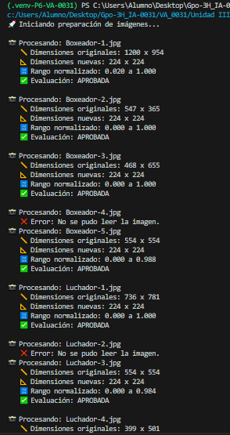   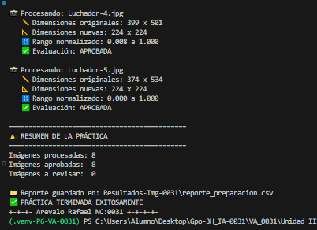

## Resultado de las carpetas
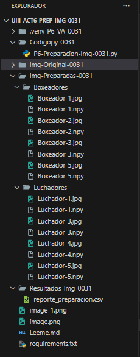

## Boxeadores
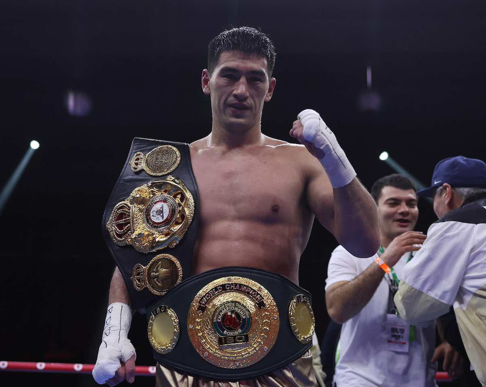 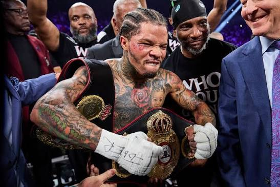
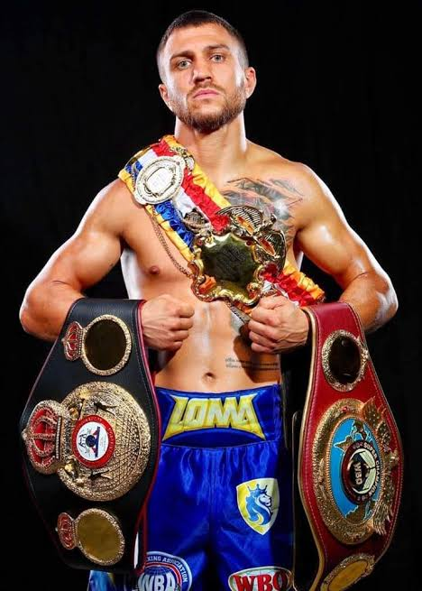 
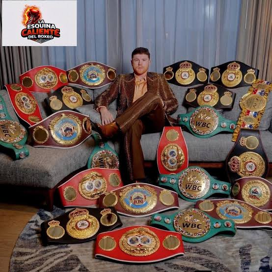 

## Luchadores
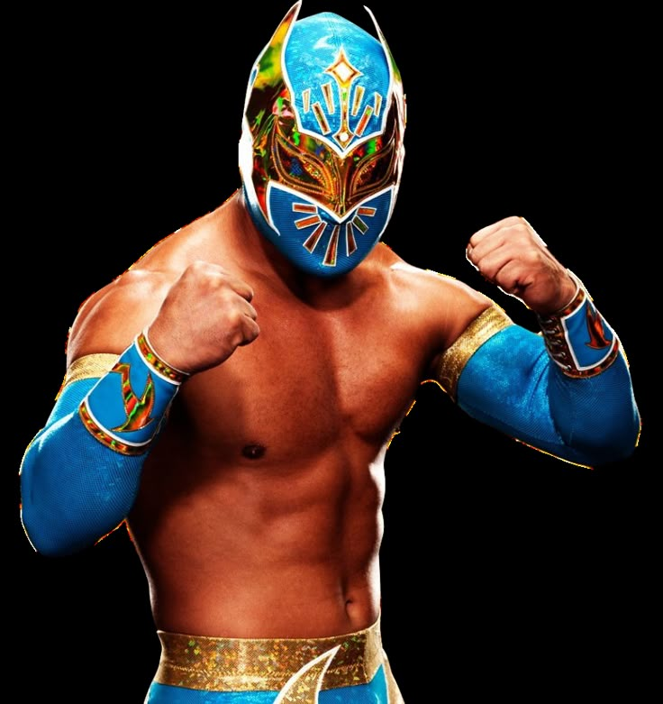 
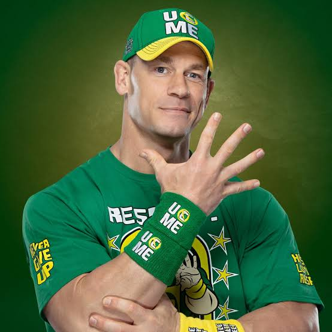 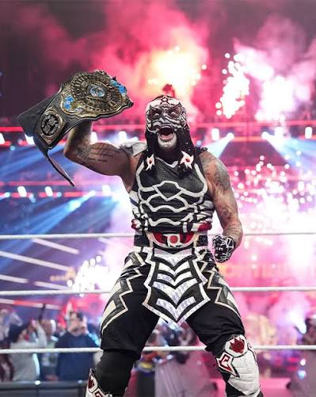
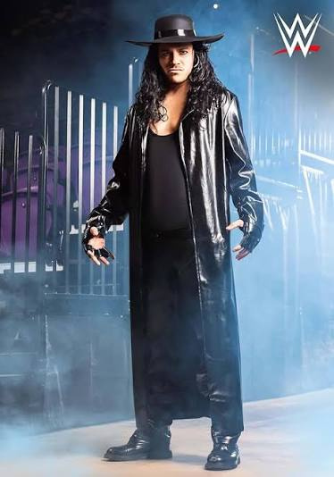